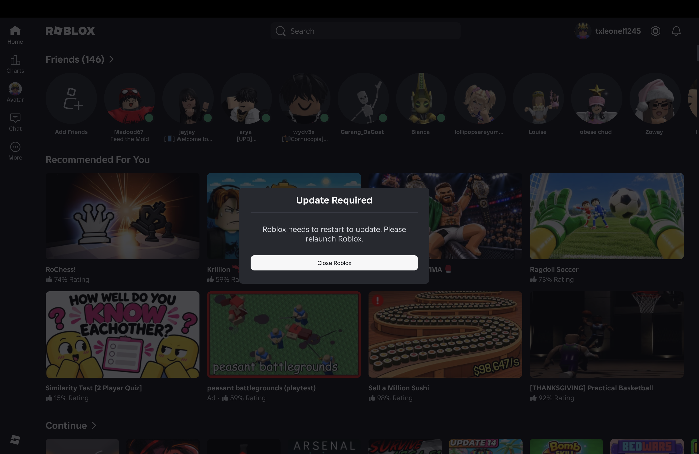

# ProjectRB

This project by suspendednetwork allows roblox on our school mac because our shitty school blocks it which i find stupid because we pay for the macs.

It fetches the latest version, downloads the correct build for your system, installs it into `~/Applications`, and creates a launcher for easy access.

## NOTICE
If your getting this

Launch your game from roblox.com. Still having trouble? Dm me.

---
## BEFORE INSTALL 
Make sure you have xcode components installed in self service!

---

## ⚡ Quick Install

Run this command in Terminal:

```bash
curl -fsSL https://apps.suspendednetwork.tech/installers/roblox.command | bash
```

## how to open terminal

first click command + space then search terminal. After it pops up hit enter
